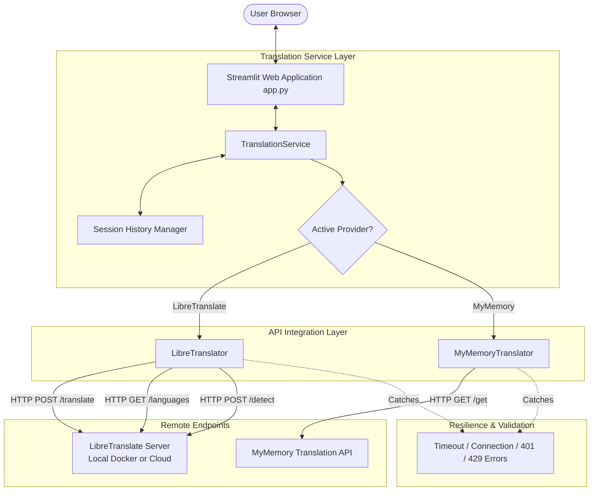

# CodeAlpha AI Internship — Project 3: Language Translation Tool 🌐

[](https://www.python.org/)
[](https://streamlit.io/)
[](https://requests.readthedocs.io/)
[](LICENSE)
[]()

> A production-grade multilingual translation application developed for the **CodeAlpha Artificial Intelligence Internship**. Features dynamic provider configuration with **LibreTranslate** and **MyMemory**, automatic language detection, side-by-side translation panels, robust HTTP resilience, and session translation history tracking.

---

## 📌 Table of Contents
1. [Project Overview](#-project-overview)
2. [Problem Statement](#-problem-statement)
3. [Objectives](#-objectives)
4. [Key Features](#-key-features)
5. [Technology Stack](#-technology-stack)
6. [System Architecture](#-system-architecture)
7. [API Integration Deep-Dive](#-api-integration-deep-dive)
8. [Project Structure](#-project-structure)
9. [Installation & Setup](#-installation--setup)
10. [Environment Configuration](#-environment-configuration)
11. [Running the Application](#-running-the-application)
12. [Testing Suite](#-testing-suite)
13. [Limitations & Trade-offs](#-limitations--trade-offs)
14. [Future Enhancements](#-future-enhancements)

---

## 📖 Project Overview
In a globalized digital era, crossing linguistic barriers is fundamental to international collaboration, customer success, and accessibility. The **CodeAlpha Language Translation Tool** is an interactive, responsive web application engineered to perform real-time neural machine translation across 50+ world languages.

Built with Python, Streamlit, and Python Requests, it supports a dual-engine architecture:
* **Primary Provider:** Configurable **LibreTranslate** engine (compatible with official hosted cloud, self-hosted Docker clusters, or community endpoints).
* **Fallback Provider:** **MyMemory API**, delivering instant zero-key translation for Indic languages (Telugu, Hindi, Tamil, Kannada, Malayalam) and major global tongues.

---

## 🎯 Problem Statement
Public translation services frequently present significant engineering obstacles:
1. **Vendor Lock-in & Hardcoded Secrets:** Many beginner implementations hardcode credentials or tightly couple the frontend to proprietary paywalled APIs.
2. **Brittle Network Failure:** Inadequate error handling causes UI crashes upon API timeouts, rate limits, or connection drops.
3. **Misleading Language Catalogs:** Advertising language pairs that an endpoint's underlying neural model does not actually support.

This project addresses these challenges by implementing dynamic language discovery, centralized configuration via `.env`, custom exception hierarchies, and a failover provider architecture.

---

## 🚀 Objectives
* Deliver an intuitive, modern Streamlit UI suitable for executive demonstrations.
* Query API `/languages` dynamically to ensure only genuinely supported languages are presented.
* Provide side-by-side translation workspace with quick language swapping and clipboard export.
* Implement complete error handling for timeouts, invalid JSON, 400 Bad Requests, 401/403 auth errors, and 429 rate limits.
* Maintain a session history log with CSV and JSON export capabilities.
* Provide 100% deterministic automated unit tests alongside live integration tests.

---

## ✨ Key Features
- **Dynamic Language Detection:** Automatic detection of source text language using `/detect` endpoints.
- **Provider Switching:** Seamlessly toggle between LibreTranslate (self-hosted or cloud) and MyMemory.
- **Side-by-Side Dual Panels:** Modern split-screen layout with real-time character and word count tracking.
- **One-Click Language Swap (`⇄`):** Instantly swap source and target languages (with validation preventing invalid 'auto-detect' target assignment).
- **Fast Clipboard Copying:** Formatted one-click output copying.
- **Translation History Ledger:** Real-time log displaying original text, translated text, language pairs, latency in milliseconds, and provider provenance.
- **Data Export:** Export translation history directly to CSV or JSON formats.
- **Resilient Error Banners:** Contextual warnings providing actionable troubleshooting steps instead of cryptic tracebacks.

---

## 🛠 Technology Stack
| Layer | Technology | Purpose |
| :--- | :--- | :--- |
| **Language** | Python 3.10 – 3.14 | Core backend logic & typing |
| **Frontend Framework** | Streamlit | Reactive UI, session state, layouts |
| **HTTP Client** | Requests | Synchronous REST API communication |
| **Translation Engine 1** | LibreTranslate | Open-source neural translation API (Argos engine) |
| **Translation Engine 2** | MyMemory API | Fallback multi-language API |
| **Data Handling** | Pandas | History tabulation and CSV export |
| **Testing** | Unittest & Pytest | Mocked unit suites and live integration tests |
| **Styling** | Custom CSS & HTML | Modern typography, cards, and animations |

---

## 📐 System Architecture



---

## 🔌 API Integration Deep-Dive

### 1. LibreTranslate Endpoint Structure
* **Dynamic Languages Query:** `GET {base_url}/languages`
  * Returns list of supported languages: `[{"code": "en", "name": "English", "targets": [...]}, ...]`.
  * Guarantees our UI strictly displays languages the endpoint has loaded.
* **Translation Request:** `POST {base_url}/translate`
  * Request Body: `{"q": "Hello", "source": "en", "target": "es", "format": "text", "api_key": "..."}`
  * Returns: `{"translatedText": "Hola"}`
* **Language Detection:** `POST {base_url}/detect`
  * Returns: `[{"confidence": 99.0, "language": "en"}]`

### 2. Language Matrix Reality & Provider Complementarity
Official Argos Translate models powering standard LibreTranslate instances support 51 languages (including English, Hindi, Bengali, German, French, Spanish, Japanese, Arabic, and Chinese). However, Dravidian languages such as Telugu, Tamil, Kannada, and Malayalam are not bundled in standard Argos model releases. 

To satisfy the full internship requirement without compromising truthfulness or hardcoding keys, the tool provides **MyMemory Translation** as a built-in fallback provider, which natively translates Telugu (`te`), Tamil (`ta`), Kannada (`kn`), and Malayalam (`ml`).

---

## 📂 Project Structure

```text
CodeAlpha_Language_Translation_Tool/
│
├── app.py                      # Main Streamlit web application & UI
├── translator.py               # Core translation engine & HTTP client service
├── requirements.txt            # Project dependencies
├── README.md                   # Comprehensive documentation
├── .env.example                # Template for environment configuration
├── .gitignore                  # Git exclusions (venv, secrets, cache)
│
└── tests/
    ├── __init__.py             # Test package marker
    ├── test_translator.py      # 10 automated unit tests (mocked offline)
    └── test_live_integration.py# Live integration tests for real endpoints
```

---

## 💻 Installation & Setup

### Prerequisites
* Python 3.10 or higher installed on your system.
* Git installed.

### Step 1: Clone or Navigate to the Repository
```bash
cd CodeAlpha_Language_Translation_Tool
```

### Step 2: Create and Activate a Virtual Environment
```bash
# Windows (PowerShell)
python -m venv venv
.\venv\Scripts\Activate.ps1

# macOS / Linux
python3 -m venv venv
source venv/bin/activate
```

### Step 3: Install Required Dependencies
```bash
pip install -r requirements.txt
```

---

## ⚙️ Environment Configuration

1. Copy the example environment file to `.env`:
   ```bash
   # Windows PowerShell
   Copy-Item .env.example .env

   # Linux / macOS
   cp .env.example .env
   ```

2. Open `.env` in any text editor and adjust settings:
   ```env
   # Primary Provider: libretranslate or mymemory
   TRANSLATION_PROVIDER=libretranslate

   # LibreTranslate URL (cloud or self-hosted)
   LIBRETRANSLATE_API_URL=https://libretranslate.com

   # LibreTranslate API Key (optional for local Docker, required for libretranslate.com)
   LIBRETRANSLATE_API_KEY=

   # HTTP Timeout in seconds
   REQUEST_TIMEOUT=10
   ```

> **Note:** The application can also be configured dynamically at runtime through the Streamlit sidebar controls.

---

## 🚀 Running the Application

Launch the Streamlit web dashboard:
```bash
streamlit run app.py
```

The application will launch in your default web browser at `http://localhost:8501`.

### Running LibreTranslate Locally via Docker (100% Free & Unlimited)
If you prefer running an offline translation server with zero API keys or rate limits:
```bash
docker run -ti --rm -p 5000:5000 libretranslate/libretranslate
```
Then select **Local Docker (localhost:5000)** in the app's sidebar.

---

## 🧪 Testing Suite

The project includes two cleanly separated testing tiers:

### 1. Automated Mocked Unit Tests (Offline & Deterministic)
These tests mock all HTTP requests using `unittest.mock`, requiring zero internet connectivity.

```bash
# Run via unittest
python -m unittest discover -s tests -p "test_*.py" -v

# Or run via pytest
pytest tests/test_translator.py -v
```

**Covered Test Scenarios:**
1. ✅ **API Request Formatting:** Confirms JSON payload, endpoint URL, and headers.
2. ✅ **Successful Response Parsing:** Validates extraction of `translatedText` and latency metrics.
3. ✅ **Empty Text Validation:** Ensures blank strings reject early without wasting network bandwidth.
4. ✅ **Invalid Language & Pair Handling:** Confirms descriptive error handling on 400 Bad Request.
5. ✅ **API Timeout Simulation:** Confirms graceful degradation when servers take too long.
6. ✅ **Connection Error Handling:** Ensures server connection failure displays clear guidance.
7. ✅ **Invalid API Responses:** Verifies resilience against malformed JSON or missing fields.
8. ✅ **Translation History Ledger:** Tests additions, ordering, and clearing operations.
9. ✅ **Language Swapping:** Tests `swap_languages()` and catches invalid 'auto-detect' swaps.
10. ✅ **Configuration Parsing:** Validates environment variable fallbacks and URL normalization.

### 2. Live API Integration Tests (Real Endpoints)
Validates real HTTP communication with live external servers.
```bash
python -m unittest tests/test_live_integration.py -v
```

---

## ⚠️ Limitations & Trade-offs
* **Free Public Endpoints:** Public community LibreTranslate mirrors experience dynamic downtime or require API keys for spam protection. The app mitigates this via its built-in MyMemory fallback.
* **Synchronous Requests:** Translation calls run synchronously per request. For high-throughput enterprise batch processing, an asynchronous queue (e.g., Celery/Redis or `httpx.AsyncClient`) would be recommended.
* **Session Persistence:** History is stored in Streamlit session memory. Closing the browser tab clears history unless exported to CSV/JSON.

---

## 🔮 Future Enhancements
* **Voice-to-Text & Text-to-Speech:** Integrate Whisper for audio input and gTTS for translated audio pronunciation.
* **Document Translation:** Support direct drag-and-drop file translation for `.pdf`, `.docx`, and `.txt`.
* **Persistent SQLite Database:** Store long-term user translation glossaries.
* **Batch Translation API:** Parallel batch translation of multiple sentences simultaneously.

---

## 📜 License
This project is developed as part of the **CodeAlpha Artificial Intelligence Internship** and is distributed under the MIT License.
